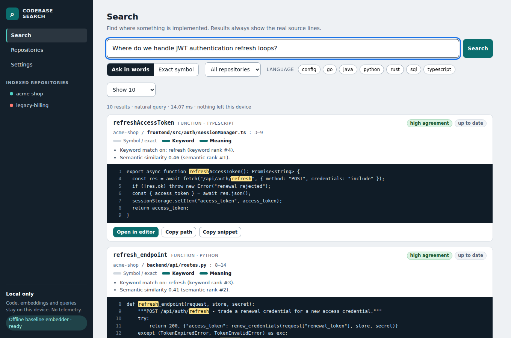
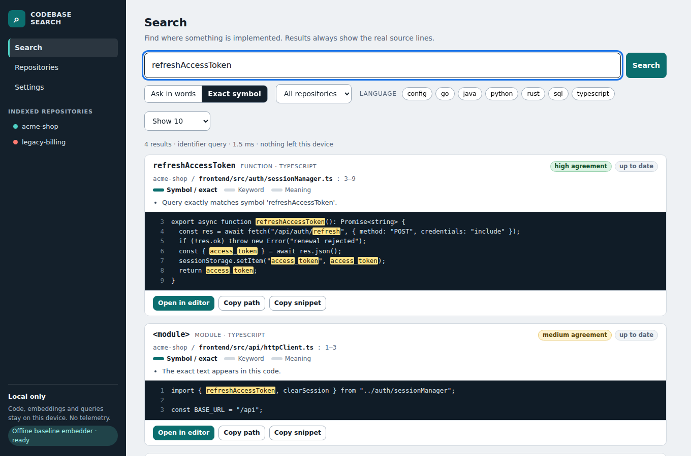
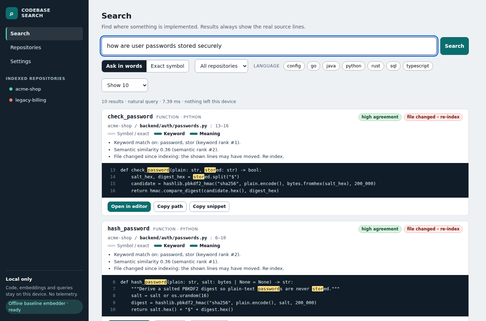
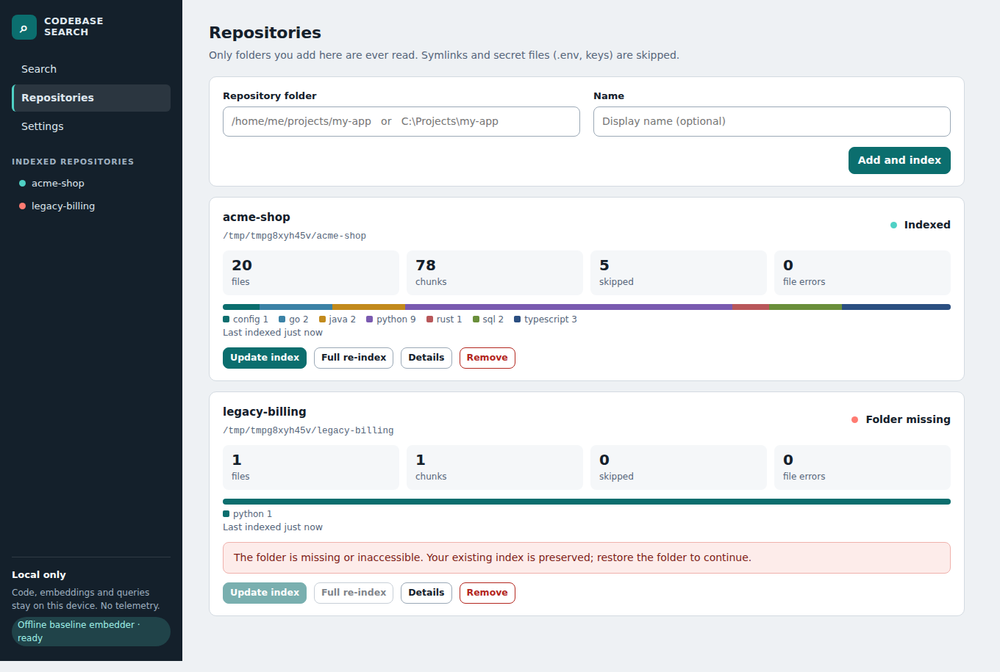
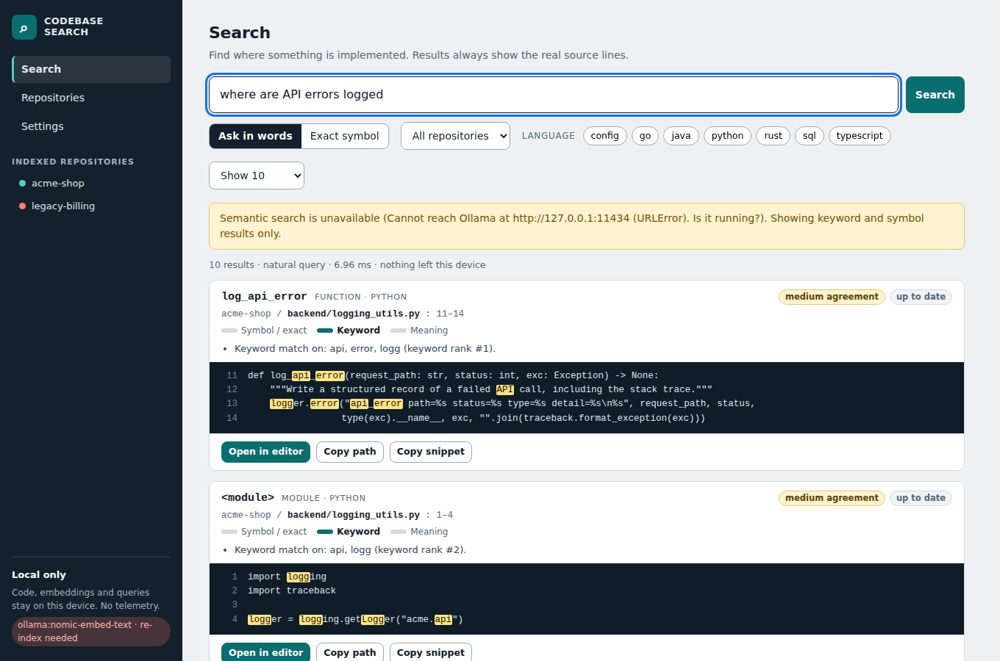
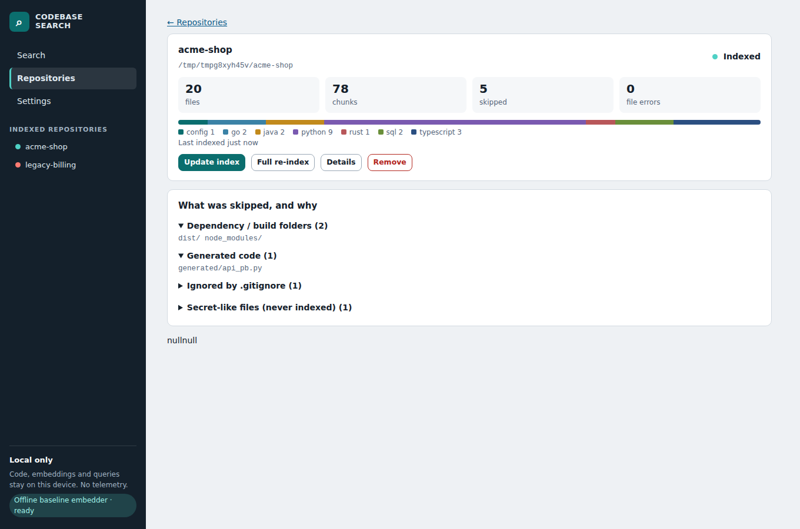
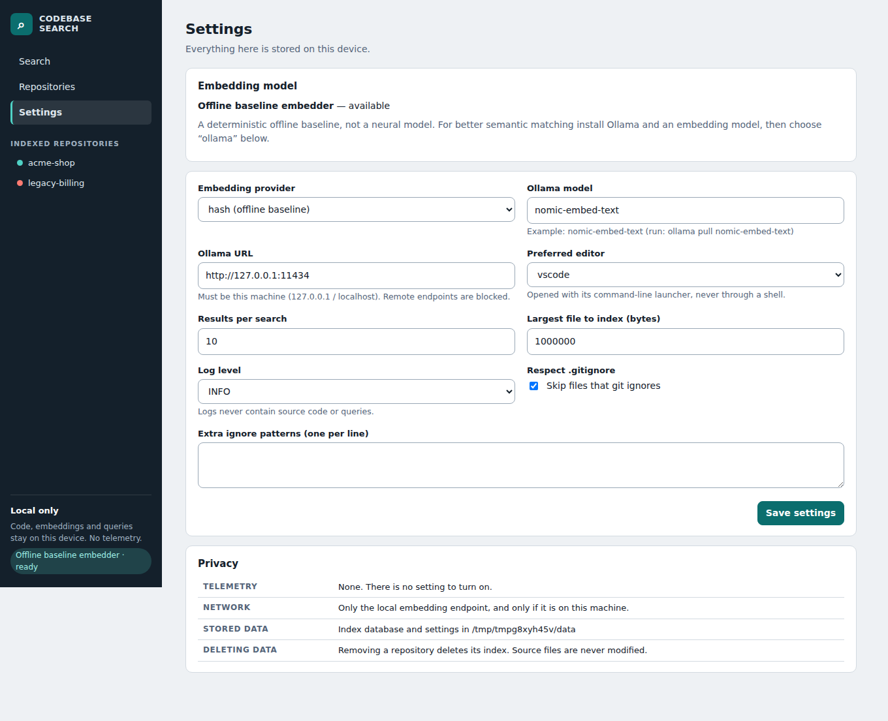

# Semantic-Local-Codebase-Search

A **privacy-first** tool that indexes a local repository and lets you find code with natural-language questions or exact symbols. Every result is real source with file path, line range, *why it matched*, a freshness check, and one-click **open at line**. Nothing leaves your machine: no cloud calls, no telemetry.
# Semantic Local Codebase Search

A **privacy-first** tool that indexes a local repository and lets you find code with natural-language questions or exact
symbols. Every result is real source with file path, line range, *why it matched*, a freshness check, and one-click
**open at line**. Nothing leaves your machine: no cloud calls, no telemetry.



## Honest status

| | |
|---|---|
|  Built and tested | Indexing engine, hybrid retrieval, SQLite index, local web UI, CLI, security guards, evaluation harness — **167 automated tests (166 pass, 1 skipped)** |
|  Limited | Ollama provider (tested against a mock server only); heuristic parsers for Rust/C#/PHP/C/C++; Linux-only testing |
|  Scaffold, **not compiled** | Tauri desktop shell (`desktop/src-tauri`) — no Rust toolchain was available |
|  Not demonstrated | That semantic search beats keyword search. On the bundled 20-query benchmark the offline baseline embedder is **on par with BM25**, not better — see [docs/evaluation.md](docs/evaluation.md) |

## Quick start
```bash
cd indexing-engine
python3 -m venv .venv && source .venv/bin/activate        # Windows: .venv\Scripts\activate
pip install -e ".[dev]"
slcs add ../sample-repositories/acme-shop --name acme-shop
slcs index acme-shop
slcs search "Where is the database connection initialized?"
slcs serve                                                # UI at http://127.0.0.1:47615/
```
Run the tests: `scripts/run_tests.sh`. Regenerate screenshots / benchmark: see [docs/installation.md](docs/installation.md).

## How it works
`scan → parse symbols → chunk by symbol → embed → one SQLite transaction per file`; a query runs **exact-symbol, literal,
BM25 keyword and vector** retrievers and merges them with reciprocal-rank fusion. Results show which signals fired, an
agreement-based confidence label (not a probability) and whether the file changed since indexing.
Embeddings: a deterministic offline baseline by default; **Ollama** (local) optional for neural embeddings.

## Screenshots
| | |
|---|---|
|  Exact symbol |  Stale result warning |
|  Repositories (incl. missing-folder state) |  Model down → keyword fallback |
|  What was skipped and why |  Settings and privacy |
More in [docs/screenshots/](docs/screenshots/) (language filter, no results, keyboard focus, narrow window).

## High-Level Architecture

                 LOCAL SOFTWARE REPOSITORY
                            |
                            v
                   Repository Scanner
                            |
                            v
                    File Security Guards
                            |
                            v
                     Language Parsers
                            |
                            v
                    Symbol-Aware Chunking
                            |
                            v
                     Embedding Provider
                      /             \
                     /               \
           Offline Baseline       Ollama
                     \               /
                      \             /
                            |
                            v
                    SQLite Index Storage
                            |
                            v
                      Search Request
                            |
          +-----------------+------------------+
          |                 |                  |
          v                 v                  v
     Exact-Symbol       Literal Search     BM25 Search
          |                 |                  |
          +-----------------+------------------+
                            |
                            v
                     Vector Retrieval
                            |
                            v
                 Reciprocal Rank Fusion
                            |
                            v
                Result Metadata and Checks
                            |
                            v
               CLI / Local Web Interface
                            |
                            v
              Source Snippets and Navigation

## Documentation
* Planning report (57 required sections): [docs/planning/00-index.md](docs/planning/00-index.md)
* [Architecture](docs/architecture.md) · [Privacy](docs/privacy.md) · [Testing](docs/testing.md) · [Evaluation](docs/evaluation.md)
* [Installation](docs/installation.md) · [Supported languages](docs/supported-languages.md)

## Structure

semantic-local-codebase-search/
│
├── indexing-engine/
│   ├── slcs/                         # Python indexing and search package
│   ├── tests/                        # Automated tests
│   ├── pyproject.toml                # Python package configuration
│   └── ...
│
├── desktop/
│   ├── ui/                           # Web UI served by the engine
│   └── src-tauri/                    # Unverified native desktop scaffold
│
├── sample-repositories/
│   └── acme-shop/                    # Example polyglot repository
│
├── scripts/
│   ├── run_tests.sh                  # Test execution script
│   ├── ...                           # Benchmark, scale and screenshot tools
│
└── docs/
    ├── planning/
    │   └── 00-index.md               # Planning report
    ├── screenshots/                  # UI screenshots
    ├── architecture.md               # Architecture documentation
    ├── privacy.md                    # Privacy design
    ├── testing.md                    # Testing documentation
    ├── evaluation.md                 # Benchmark results
    ├── installation.md               # Setup instructions
    └── supported-languages.md        # Language support

